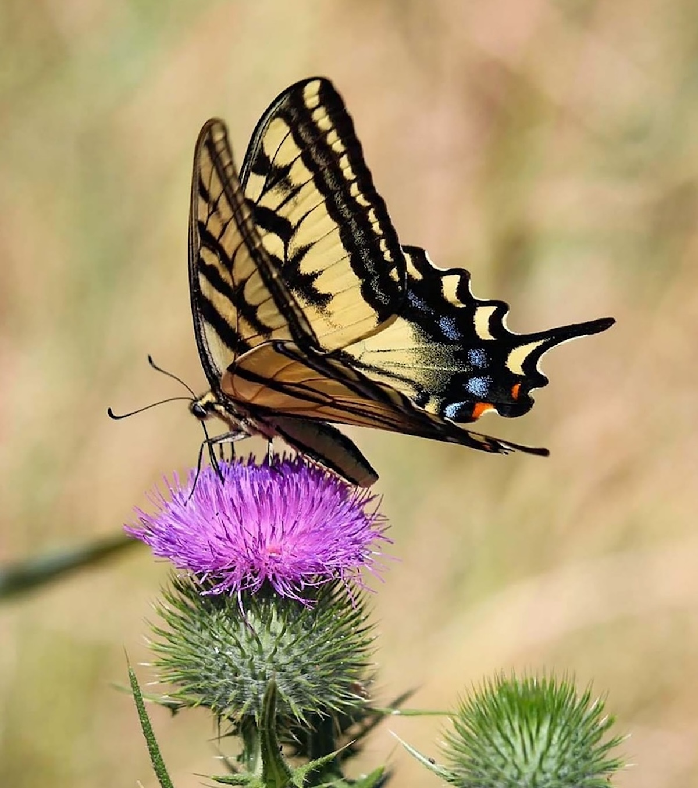

::: {.about-grid}

::: {.about-text}

#

Welcome to my stupid little page!!
:::

::: {.about-image}
```{=html}
<div class="photo-credit">
  
  <span class="credit-text">Picture by 3dogfarm via Pixabay</span>
</div>
```
:::

:::

```{=html}
<div style="text-align: center; margin-top: 18rem;">
  <a class="btn btn-outline-secondary btn-sm" href="https://github.com/data-butterfly">
    <i class="bi bi-github"></i> GitHub
  </a>
</div>
```